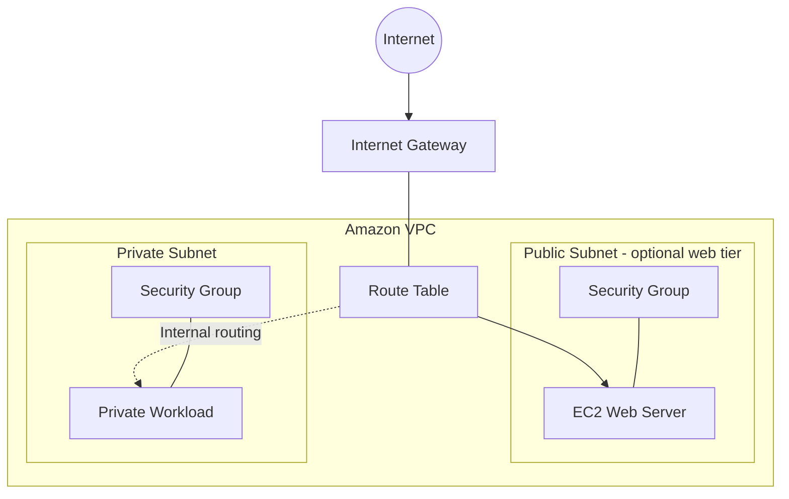

# AWS VPC and EC2 Infrastructure

**Portfolio:** AWS re/Start hands-on lab  
**Focus:** Cloud networking, compute, security, and Infrastructure as Code

## Project Overview

This portfolio project documents my learning and practical exercises in building AWS infrastructure using Amazon Virtual Private Cloud (VPC), subnets, security groups, and Amazon EC2.

The project also covers Infrastructure as Code concepts using AWS CloudFormation, with an emphasis on understanding resource dependencies, deployment troubleshooting, and secure network design.

## Objectives

- Understand VPCs and subnet design.
- Explore public and private IP addressing and network routing.
- Configure security groups to control network traffic.
- Understand EC2 instance deployment and connectivity.
- Explore CloudFormation templates for repeatable infrastructure deployment.
- Practice identifying and troubleshooting infrastructure configuration errors.

## AWS Services and Technologies

| Service / Technology | Purpose |
| --- | --- |
| Amazon VPC | Isolated virtual network |
| Subnets | Divide a VPC into network segments |
| Internet Gateway | Provides an internet route for eligible resources |
| Route Tables | Control network traffic routing |
| Amazon EC2 | Virtual compute instances |
| Security Groups | Stateful network access controls |
| AWS CloudFormation | Infrastructure as Code |
| AWS Management Console | Configure and inspect resources |

## Architecture

The following diagram illustrates the core networking concepts covered by this project. It is a conceptual architecture, not a claim that this exact topology was deployed.

**Networking note:** A private subnet does not provide direct internet access simply because an internet gateway is attached to the VPC. Routes, security controls, and any required outbound connectivity must be configured appropriately.

## Implementation and Learning Activities

### 1. Network Design
- Examine VPC CIDR ranges and subnet addressing.
- Understand public versus private IPv4 addresses.
- Review route tables and internet gateway connectivity.

### 2. EC2 Infrastructure
- Explore EC2 instance configuration and launch requirements.
- Understand the relationship between subnets, security groups, and instance networking.
- Investigate common instance deployment and connectivity errors.

### 3. Security
- Review inbound and outbound security group rules.
- Apply the principle of least privilege.
- Understand why administrative access should be restricted to trusted sources.

### 4. Infrastructure as Code
- Explore CloudFormation templates and resource declarations.
- Understand dependencies between network and compute resources.
- Review deployment errors and resource configuration issues.

## Validation and Evidence

For the completed lab exercises, I will document the relevant checks and supporting evidence, where available:

- VPC and subnet configuration
- Route table associations and routes
- Security group rules
- EC2 instance state and network configuration
- CloudFormation stack status and deployment events

Screenshots and results will be added only when verified against the actual lab environment.

## Key Takeaways

This project brings together foundational AWS networking and compute concepts. It reinforces how virtual networks, routing, security controls, and infrastructure definitions work together when designing cloud environments.

## Project Context

This work is based on AWS re/Start educational lab exercises. It is a learning portfolio, not a representation of a production environment.

## Project Status

**Current stage:** Infrastructure definition and documentation

### Completed
- [x] Created the public GitHub project repository.
- [x] Documented the project objectives and AWS components.
- [x] Added a CloudFormation template for the VPC and EC2 resources.
- [x] Added an infrastructure validation checklist.
- [x] Documented the intended architecture and security considerations.

### Not yet verified
- [ ] CloudFormation template validation in AWS.
- [ ] Successful stack deployment.
- [ ] Verification of deployed resources in the AWS Console.
- [ ] Testing of network connectivity and access controls.

### Learning outcomes
This project demonstrates foundational AWS concepts involving VPC networking, subnets, route tables, Internet Gateways, security groups, EC2, and infrastructure as code.

*This is an educational portfolio project. Completion of the documentation does not imply successful deployment or production readiness.*

---

**Author:** Sabeeh Alvi  
**GitHub:** [sabeeh-alvi](https://github.com/sabeeh-alvi)
