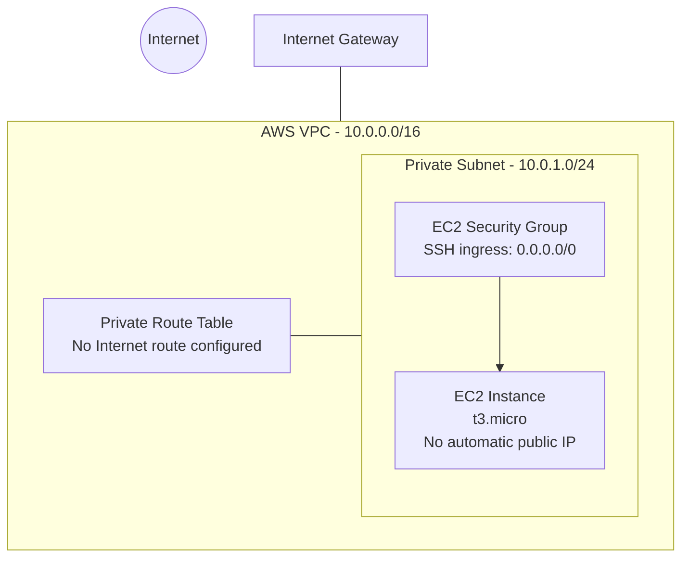

# Infrastructure Architecture

## Overview

This project uses AWS CloudFormation to define a Virtual Private Cloud (VPC), an attached Internet Gateway, a private subnet, a route table, a security group, and an EC2 instance.

## Architecture diagram

## Key design points

- **VPC:** provides an isolated logical network.
- **Private subnet:** hosts the EC2 instance without automatically assigning it a public IPv4 address.
- **Internet Gateway:** attached to the VPC, but not used by the private subnet's route table for internet access.
- **Route table:** has no internet-bound route configured by this template.
- **Security group:** allows inbound SSH, although the private instance is not directly reachable from the public internet without additional networking and access configuration.

## Important security note

The SSH rule allowing traffic from `0.0.0.0/0` is intentionally documented as an educational configuration, not a production recommendation. Restrict access to trusted sources or use an appropriate managed access method.

## Project status

This diagram describes the resources defined in the template. It does not confirm that the infrastructure has been deployed or tested in AWS.
